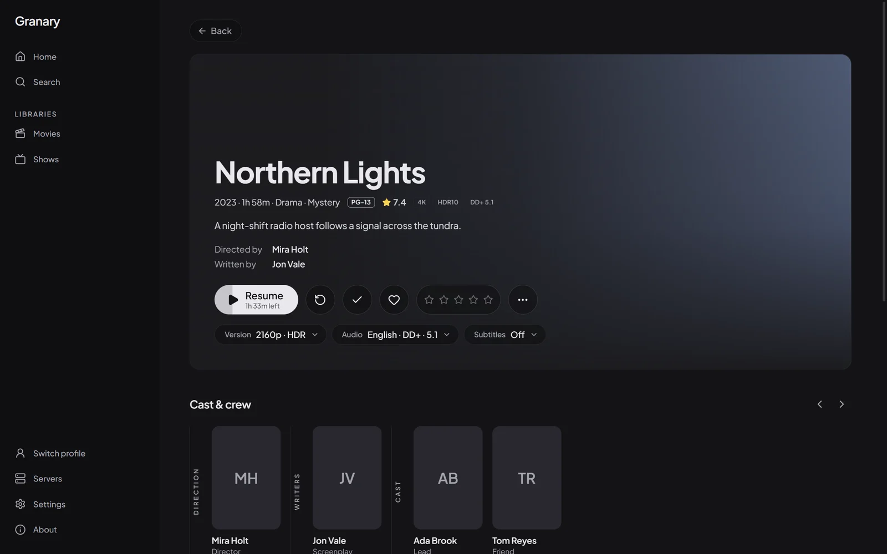
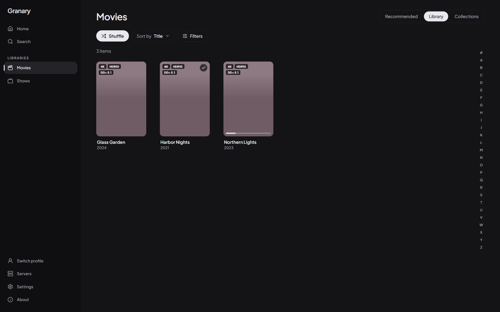
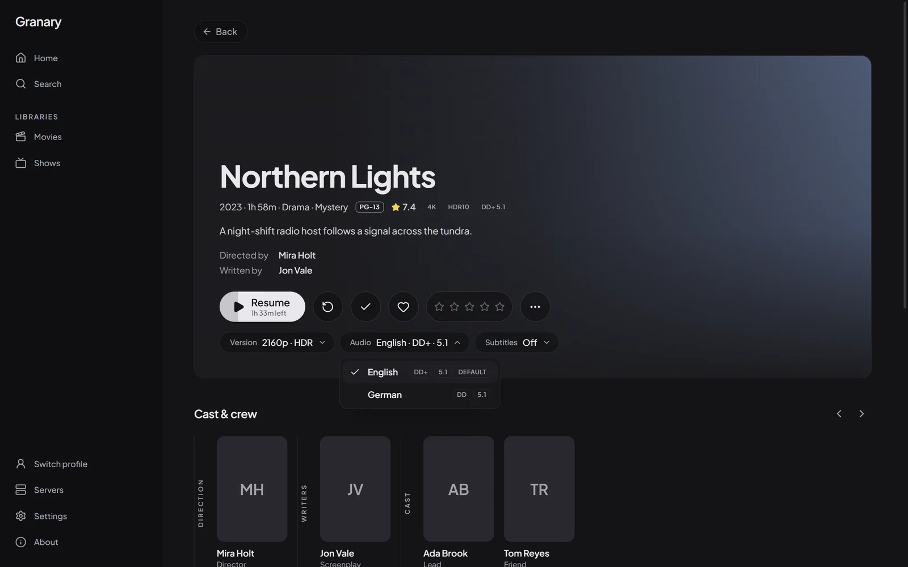
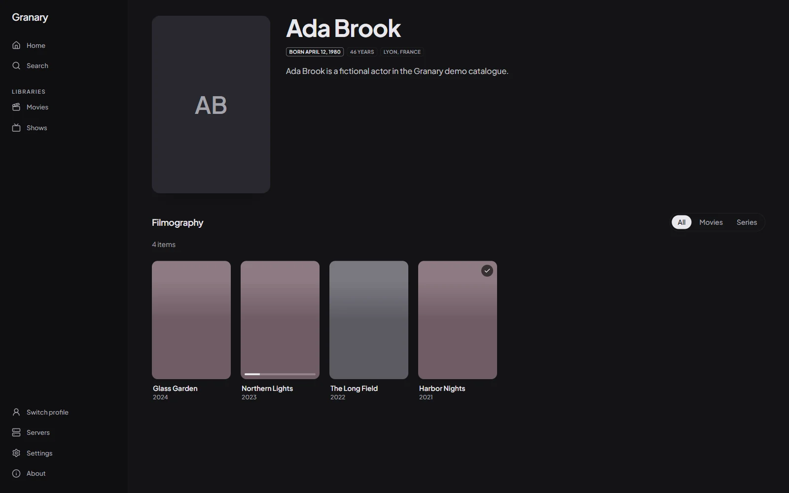
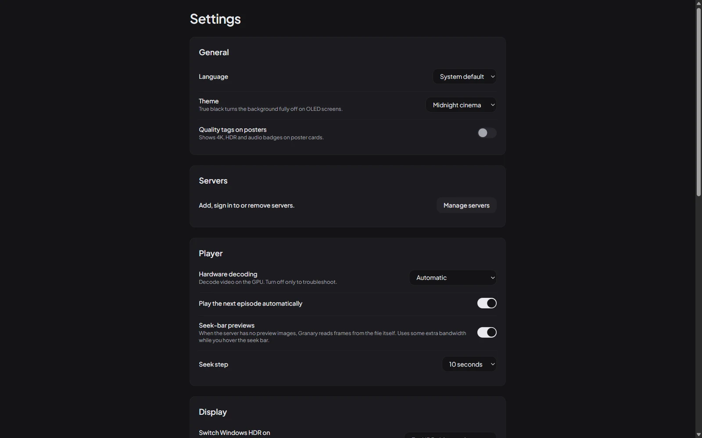

<div align="center">


# Granary

**Your library, played the way it was mastered.**

A native Windows desktop client for self-hosted media servers, compatible with
[Silo](https://github.com/Silo-Server/silo-server). mpv and libplacebo do the playback, HDR lands correctly on OLED
monitors, and every display change is put back when you stop.

[](#install)
[](LICENSE)
[](docs/ARCHITECTURE.md)
[](docs/adr/0002-player-integration.md)

[Website](https://mrghxst.github.io/granary-desktop/) ·
[Docs](https://mrghxst.github.io/granary-desktop/docs/) ·
[Releases](https://github.com/mrghxst/granary-desktop/releases) ·
[Changelog](CHANGELOG.md)

<br>



</div>

---

## Why

Browsers limit codecs and HDR, cannot switch the display's HDR mode or refresh rate, and cannot pass audio through to
a receiver. Granary keeps the calm look of the server's web app and hands playback to mpv instead:

- **Direct play** of 4K HDR10 and Dolby Vision remuxes with hardware decoding.
- **HDR that fits the panel**: libplacebo tone-maps to your monitor's real peak brightness, read from DXGI and
  adjustable per monitor, also when Windows HDR is always on.
- **Always restored**: HDR switching and refresh-rate matching are optional, and every change is undone, even after a
  crash, through a restore marker repaired at the next start.
- **Smooth** at high refresh rates and with VRR.
- **Quiet on OLED**: controls and cursor fade out, no static element stays on screen.
- **Receiver-ready**, opt-in: exclusive mode and passthrough for AC-3, E-AC-3, TrueHD, DTS and DTS-HD.

## Features

<table>
<tr>
<td width="50%" valign="top">

**Browse**
- Home rows from the server, with a fullscreen launch screen while it loads.
- Libraries with Recommended, Library and Collections tabs, infinite scroll, an A–Z rail, filters and sorting.
- Optional quality tags (4K, HDR10, Dolby Vision, Atmos) on posters.
- Detail pages: progress-aware play button, audio and subtitle languages at a glance, tags, trailers, mark watched,
  favourite, and cast and crew that open person pages.
- Search, series, seasons and episodes.

</td>
<td width="50%" valign="top">

**Play**
- `gpu-next` on D3D11 with d3d11va hardware decoding.
- Direct play, remux or transcode, decided by the server.
- Resume points and progress reporting, next episode across seasons.
- Intro and credits skip, chapters.
- **Seek-bar previews**: the server's trickplay sheets, or frames decoded locally from the file when the server has
  none.
- Language-first audio and subtitle menus, statistics, mini player, media keys.

</td>
</tr>
<tr>
<td valign="top">

**Display and audio**
- Per-monitor HDR policy, peak and black level.
- Refresh-rate matching, skipped on VRR monitors.
- Output device, channel layout, exclusive mode, passthrough.

</td>
<td valign="top">

**Everything else**
- Sign-ins in Windows Credential Manager; the UI never sees a token.
- English and German, full keyboard control, layout-aware shortcuts.
- Redacted logs, an offline banner with automatic reload, optional power-user `mpv.conf`.
- No telemetry, no auto-updater.

</td>
</tr>
</table>

<div align="center">




</div>

## Install

**Requirements:** Windows 11 x64 with an AVX2 CPU (Intel Haswell / AMD Zen or later), a GPU with D3D11 video decoding,
and the WebView2 runtime (ships with Windows 11; the installer fetches it if missing).

1. Download `Granary_<version>_x64-setup.exe` and its `.sha256` from the
   [releases page](https://github.com/mrghxst/granary-desktop/releases) and check the hash:
   ```powershell
   Get-FileHash -Algorithm SHA256 .\Granary_<version>_x64-setup.exe
   ```
2. Run the installer. It installs per user, without administrator rights. The build is not code-signed yet
   ([`docs/signing.md`](docs/signing.md)), so SmartScreen asks: choose **More info → Run anyway**.
3. Start Granary, add your server address and sign in.

Uninstall through **Settings → Apps → Granary**; tick "Delete the application data" to remove settings, logs and the
shader cache too.

> **Status: 0.2 test release, unsigned.** Automated tests ran on a laptop with an HDR panel, synthetic clips and a
> mock server. Dolby Vision remuxes, OLED desktop monitors, VRR, receivers and real servers still need hands-on checks:
> see [`MANUAL_TEST_CHECKLIST.md`](MANUAL_TEST_CHECKLIST.md). Reports are welcome.

## Keyboard

mpv-like defaults; press `?` or F1 while playing for the full list.

| Keys | Action | Keys | Action |
| --- | --- | --- | --- |
| Space, k | Play / pause | f, double-click | Fullscreen |
| ← / → | Seek | ↓ / ↑ | Large seek |
| PageDown / PageUp | Chapter | 9 / 0 | Volume |
| a / v | Audio track / subtitles | i | Statistics |
| N / P | Next / previous episode | T | Mini player |
| q | Stop | Esc | Leave fullscreen / close menus |

All shortcuts are in the [docs](https://mrghxst.github.io/granary-desktop/docs/shortcuts/).

## Build from source

You need Windows 11 x64, Visual Studio 2022 Build Tools ("Desktop development with C++"),
[rustup](https://rustup.rs) (toolchain pinned in `rust-toolchain.toml`), Node.js 24 with corepack, and 7-Zip.
ffmpeg is optional, for test media.

```powershell
corepack enable
pnpm install --frozen-lockfile
./scripts/fetch-libmpv.ps1          # pinned libmpv, SHA-256 verified, into vendor-bin/
./scripts/verify.ps1                # fmt, clippy -D warnings, tests, typecheck, lint, vitest, build, secret scan
pnpm --filter desktop tauri dev     # run the app
./scripts/release-build.ps1         # NSIS installer in target/release/bundle/nsis/
```

No server at hand? Debug builds include a mock: set `GRANARY_MOCK_SERVER=1`, sign in as `alice` / `pw` (Kids PIN
`1234`), and run `./scripts/gen-test-media.ps1` for playable clips.

The website and docs live in [`site/`](site) (Next.js static export with Fumadocs):

```powershell
cd site; pnpm install; pnpm dev
```

See [`CONTRIBUTING.md`](CONTRIBUTING.md) for the workflow and rules.

## Architecture

```
┌──────────────────────── Granary main window (Tauri 2) ────────────────────────┐
│  WebView2 (React UI, transparent while playing)    ← controls, menus, library │
│  ─────────────────────────────────────────────────────────────────────────────│
│  GranaryVideo child window  ← libmpv renders here (gpu-next, D3D11 swapchain) │
└───────────────────────────────────────────────────────────────────────────────┘
        ▲ typed Tauri commands / events (no tokens)
┌───────┴────────────── Rust host (apps/desktop/src-tauri) ─────────────────────┐
│ silo.rs / catalog.rs ── crates/silo-api ── HTTPS ──► media server             │
│ playback/ host · controller · relay (127.0.0.1) ── crates/player ── libmpv    │
│ crates/display ── HDR / refresh / DXGI luminance / restore marker             │
│ settings · redacting logs · About                                             │
└───────────────────────────────────────────────────────────────────────────────┘
```

| Path | What |
| --- | --- |
| [`apps/desktop`](apps/desktop) | Tauri app: React UI (`src/`) and Rust host (`src-tauri/`) |
| [`crates/player`](crates/player) | libmpv wrapper, option layering, state machine, seek previews |
| [`crates/display`](crates/display) | HDR, SDR white, refresh rate, DXGI luminance, restore marker |
| [`crates/silo-api`](crates/silo-api) | Typed server client, credential store, events socket, mock server |
| [`site`](site) | Website and documentation |

More in [`docs/ARCHITECTURE.md`](docs/ARCHITECTURE.md) and the decision records in [`docs/adr/`](docs/adr). Granary
never guesses an endpoint: every server call is listed with its upstream source in
[`docs/research/silo-api.md`](docs/research/silo-api.md).

## How it was built

Granary was written almost entirely by **[Claude Code](https://claude.com/claude-code)**, working from a written
specification under a human's supervision. Nothing about that is hidden; the working files stay in the repository:

- [`CLAUDE.md`](CLAUDE.md): the agent's standing instructions and non-negotiable rules.
- [`PROGRESS.md`](PROGRESS.md): phases, decisions, blockers and a log of every step.
- [`docs/adr/`](docs/adr): architecture decision records.
- [`docs/reviews/`](docs/reviews): an independent review of each phase and how every finding was resolved.
- [`docs/evidence/`](docs/evidence): measurements and test runs behind each gate.

Every step had to pass `scripts/verify.ps1` before it was committed. More on the
[website](https://mrghxst.github.io/granary-desktop/docs/how-it-was-built/).

## More docs

- [`MANUAL_TEST_CHECKLIST.md`](MANUAL_TEST_CHECKLIST.md): checks that need a person, real displays or a real server.
- [`docs/security.md`](docs/security.md): security review, residual risks and dependency audits.
- [`docs/perf.md`](docs/perf.md): cold start, memory and time to first frame.
- [`docs/signing.md`](docs/signing.md): code-signing plan.

## License

[GNU Affero General Public License v3.0 or later](LICENSE). Granary bundles libmpv (GPL-3.0-or-later build) and
FFmpeg; versions, source links and the other third-party licences are in
[`THIRD_PARTY_NOTICES.md`](THIRD_PARTY_NOTICES.md), and the About screen links to the exact source commit of each
build.

<sub>Granary is an independent project and is not affiliated with or endorsed by Silo Media L.L.C. "Silo" is their
trademark; Granary is compatible with Silo and nothing more.</sub>
